# 1.14.2 native QA: 푸시 알림 권한·토큰

검증 기준: `stack:1.14.2` tip. Docker 개발 API·PostgreSQL에 마이그레이션을 적용하고 로컬 테스트 계정만 썼다. 운영 계정·운영 DB는 바꾸지 않았다. 계정 비밀번호·푸시 토큰 값은 저장소에 남기지 않는다.

## 환경

| 항목       | 환경                                                                  |
| ---------- | --------------------------------------------------------------------- |
| 시뮬레이터 | iPhone 18 Pro Simulator / iOS 27.0 / 한국어 / 다크                    |
| 실기기     | iPhone Duo / iOS 27.3 / 개발 빌드(Debug, `com.aido.mobile.dev`)       |
| 앱         | 1.14.2, Expo SDK 58, expo-notifications 58                            |
| 자동화     | Maestro, `xcrun simctl push`, Expo Push API(`exp.host`) 1회 수동 발송 |
| 확인       | 화면 + 같은 시점 `PushDevice`·`PushToken` 행, 앱·서버 로그            |

## 시나리오

| 시나리오                                 | 시뮬레이터 | 실기기 | 서버 상태                                       |
| ---------------------------------------- | ---------- | ------ | ----------------------------------------------- |
| 처음 실행: 홈 카드 → 앱 안내 → 시스템 창 | 통과       | 미기록 | 묻기 전 `NOT_DETERMINED`, 토큰 없음             |
| 허용                                     | 통과       | 통과   | `GRANTED`, 토큰 저장, 세션 연결                 |
| 거절                                     | 통과       | 통과   | `DENIED`·`canAskAgain=false`, 그 기기 토큰 삭제 |
| iOS 설정에서 다시 켜고 복귀              | 통과       | 통과   | `GRANTED`, 토큰 다시 등록                       |
| 앱 안 "푸시 알림" 토글 끔                | 통과       | 통과   | `pushEnabled=false`, 토큰 유지(발송만 건너뜀)   |
| Expo로 실제 발송 → 탭                    | 해당 없음  | 통과   | 영수증 `ok`, 알림 탭으로 날씨 화면 이동         |
| 앱이 켜져 있을 때 배너                   | 통과       | 미기록 | `simctl push` / Expo 발송                       |
| 로그아웃                                 | 통과       | 통과   | 기기·토큰 행 0건                                |

시뮬레이터 토큰은 Expo 발송에서 APNs `BadDeviceToken`으로 거부된다. 같은 개발 빌드의 실기기 토큰은 `ok`라 자격 증명 문제는 아니다. 실제 발송 확인은 실기기로 한다.

## 화면

| 1. 홈 카드                                       | 2. 앱 안내                                         | 3. 시스템 창                                                | 4. 허용 뒤 홈                                   |
| ------------------------------------------------ | -------------------------------------------------- | ----------------------------------------------------------- | ----------------------------------------------- |
| 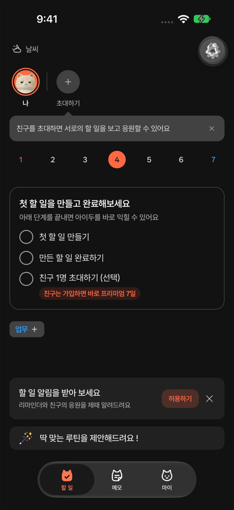 | 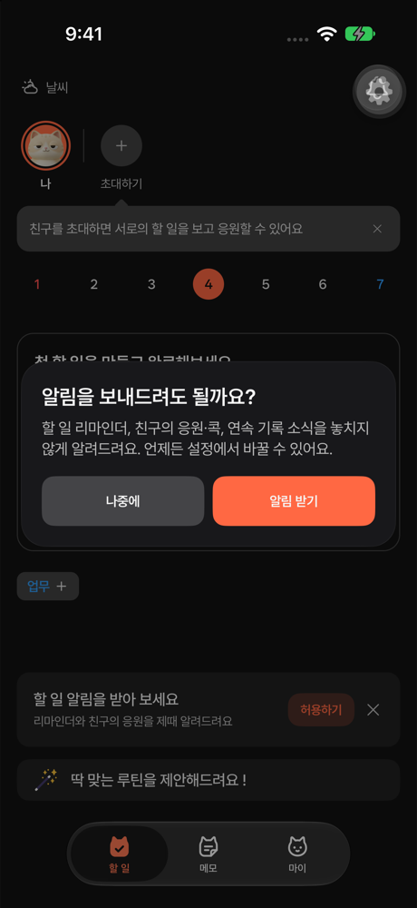 | 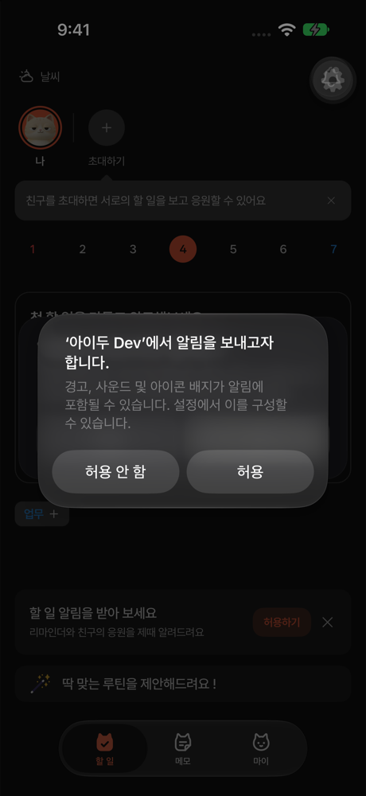 | 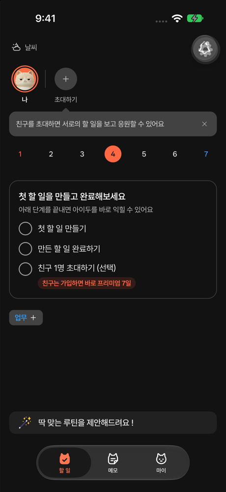 |

| 5. 거절 뒤 홈                                       | 6. 거절 뒤 설정                                        | 7. iOS 설정에서 켬                                       | 8. 복귀 뒤 설정                                         |
| --------------------------------------------------- | ------------------------------------------------------ | -------------------------------------------------------- | ------------------------------------------------------- |
| 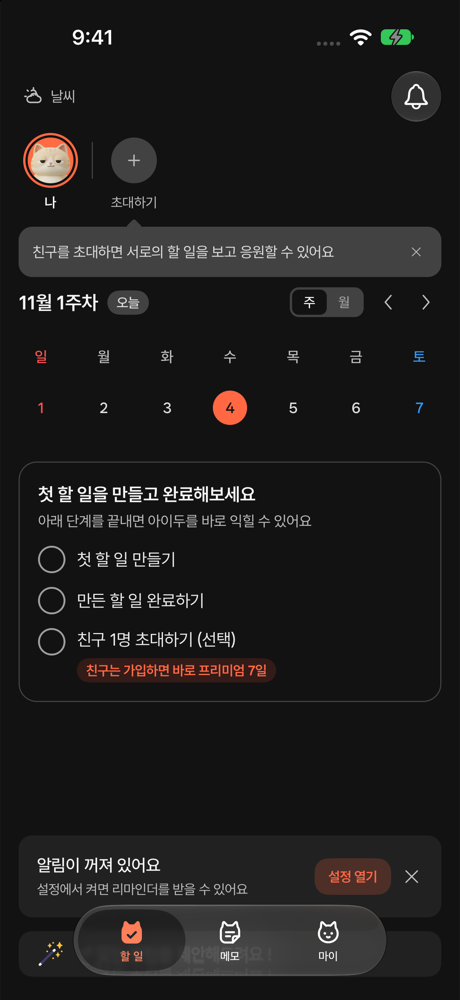 | 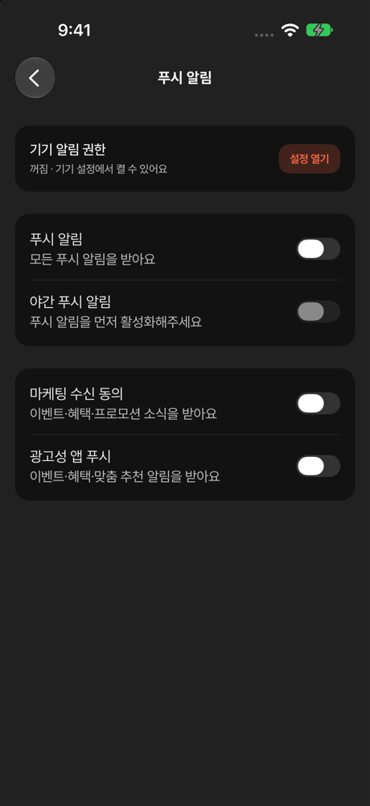 | 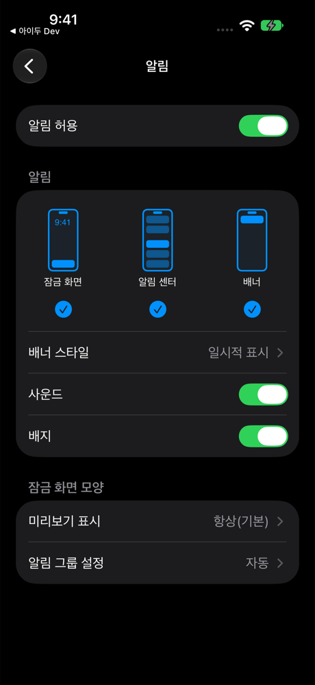 | 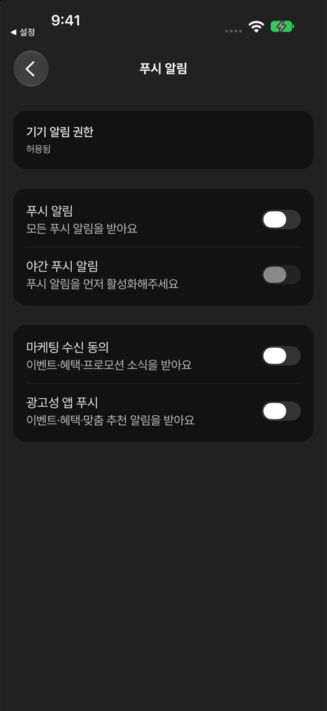 |

| 9. 앱 푸시 꺼짐                                      | 10. 앱 사용 중 배너                                  | 실기기: 거절 뒤 설정                                              |
| ---------------------------------------------------- | ---------------------------------------------------- | ----------------------------------------------------------------- |
| 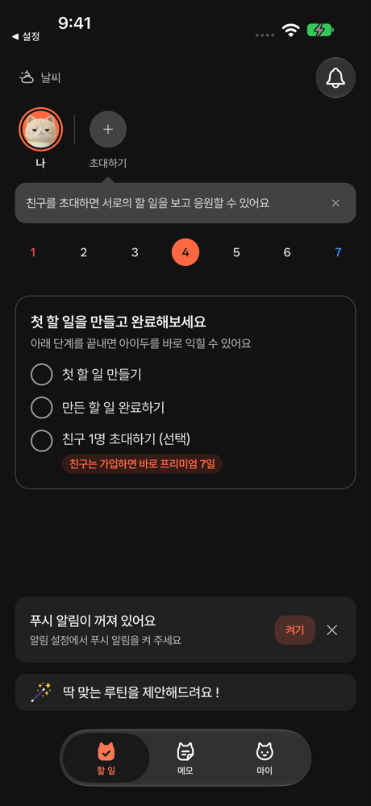 | 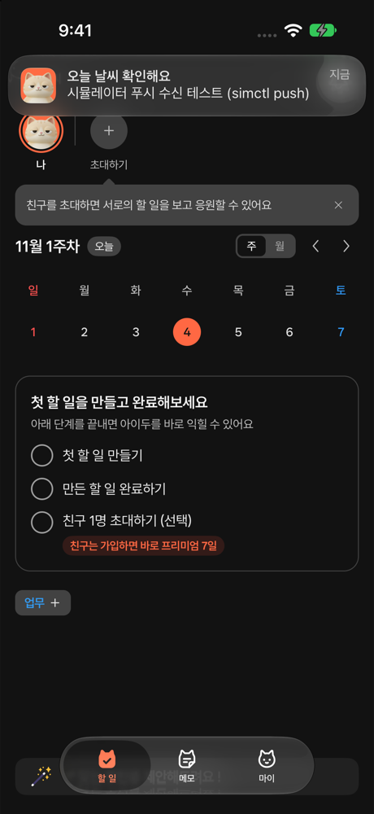 | 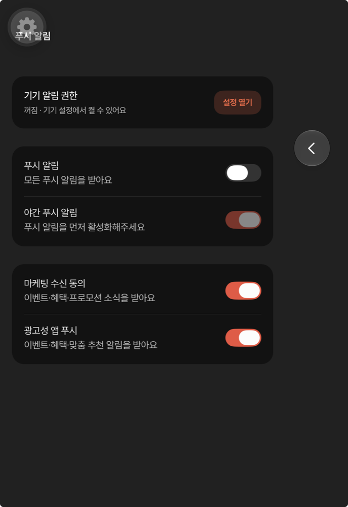 |

실기기는 허용 뒤부터 확인했고, 알림 도착 시 앱이 앞에 있었는지는 기록하지 않았다(미기록). 실기기 캡처의 톱니·뒤로 버튼은 개발 빌드 도구라 출시 빌드에는 없다.

## 확인하지 못한 것

- Android 화면 흐름과 실기기 토큰 발급·발송. 채널을 권한 요청 전에 만드는 순서는 `push-device.service.test.ts` 단위 테스트로만 확인했다.
- iOS 16.4~17 실기기 실행(nitro 0.37.2 심볼은 `nm -u`로만 확인).
